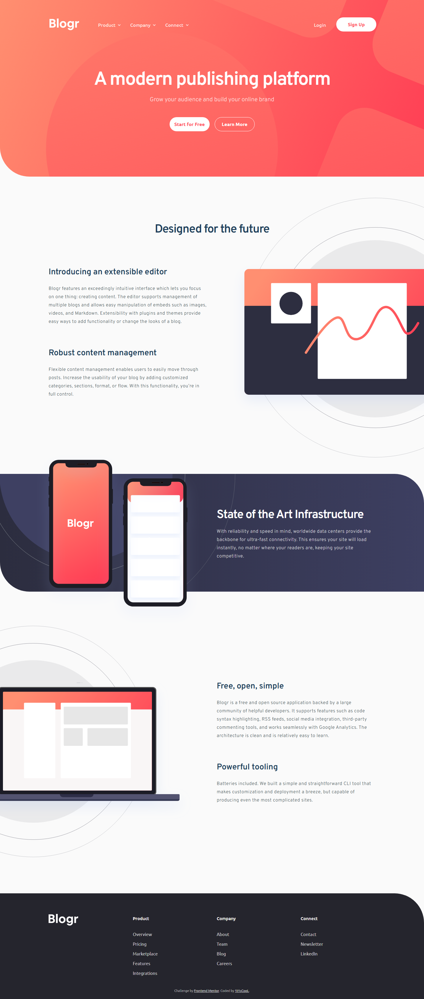

# Frontend Mentor - Blogr landing page solution

This is a solution to the [Blogr landing page challenge on Frontend Mentor](https://www.frontendmentor.io/challenges/blogr-landing-page-EX2RLAApP). Frontend Mentor challenges help you improve your coding skills by building realistic projects.

## Table of contents

- [Overview](#overview)
  - [The challenge](#the-challenge)
  - [Screenshot](#screenshot)
  - [Links](#links)
- [My process](#my-process)
  - [Built with](#built-with)
  - [What I learned](#what-i-learned)
  - [Continued development](#continued-development)
  - [Useful resources](#useful-resources)
- [Development](#development)
- [Author](#author)

## Overview

### The challenge

Users should be able to:

- View the optimal layout for the site depending on their device's screen size
- See hover states for all interactive elements on the page

### Screenshot

| Desktop                              | Mobile                             |
| ------------------------------------ | ---------------------------------- |
|  |  |

### Links

- Solution URL: [Vercel](https://blogr-landing-page-main-brown-xi.vercel.app/)
- Live Site URL: [mmalabugin.ru/BlogrLandingPage](https://mmalabugin.ru/BlogrLandingPage/)

## My process

### Built with

- **[Ember 7.4](https://emberjs.com/) (Polaris)** — this challenge's new framework. Every component is a `.gts` file with a `<template>` tag: template-only components are typed with `TOC<Signature>`, the one stateful component is a `@glimmer/component` class. Reactivity is `@tracked` fields; there are no controllers, no routes beyond `application`, no WarpDrive.
- **Embroider + Vite 8.** `@embroider/vite` (`classicEmberSupport()` + `ember()`) compiles the app as native ES modules; the router uses `locationType: 'none'`, so moving the site under a sub-path only needs Vite's `base`.
- **FSD layout.** `app/pages/landing`, `widgets` (`site-header`, `intro`, `designed-for-future`, `infrastructure`, `tooling`, `site-footer`), `features/navigation-menu`, `entities` (`nav`, `feature`), `shared` (logo, icons, button link, art-directed image, the `onDismiss` modifier, asset URLs). Header and footer navigation render from the same `NAV_GROUPS` model; all copy for the three content sections lives in `FEATURES`.
- **Logic out of templates.** `MenuState` (one open dropdown at a time, the mobile menu, `closeAll`) is a plain class with `@tracked` fields and arrow-function methods, so it can be passed to `{{on}}` without `@action` and unit-tested without rendering.
- **`onDismiss` function modifier** (`ember-modifier`). It subscribes to `click` and `keydown` on `document` only while a menu is open (`enabled=this.state.isAnyOpen`) and tears the listeners down otherwise. Escape returns focus to the trigger that opened the menu.
- **Accessibility.** Disclosure buttons with `aria-expanded` / `aria-controls` and the `hidden` attribute (not `display` hacks) for submenus, a labelled `<nav aria-label="Primary">`, sections labelled by their headings, a single `h1`, footer link groups as `<nav>` labelled by their `h2`, and `:focus-visible` rings.
- **Performance.** `<picture>` with a mobile `<source>` so phones never download the desktop illustrations; intrinsic `width`/`height` on every image (no CLS); `loading="lazy"` below the fold. Overpass and Ubuntu are subset to Latin woff2 (29–35 kB each), preloaded from the same URLs as `@font-face`, with `font-display: optional`. CSS is 2.9 kB gzipped.
- Desktop-first CSS (BEM), `em` media queries, `rem` sizes, and transitions only inside `@media (prefers-reduced-motion: no-preference)`.
- **Tests:** QUnit + qunit-dom in headless Chrome via testem — 86 tests: unit (models, `MenuState`, dismiss helpers, asset URLs), rendering tests for every component and widget, and an acceptance test for the whole navigation flow on `visit('/')`.

### What I learned

- **A detached target makes "click outside" lie.** Tapping the hamburger opened the menu and Ember re-rendered the button in a microtask — the hamburger SVG was replaced by the close icon. Microtasks run between event listeners of a real user click, so by the time the click bubbled to `document` the original `<path>` target was no longer in the DOM, `element.contains(target)` returned `false`, and the menu closed itself immediately. The fix is `event.composedPath()`: the path is snapshotted at dispatch, so it still contains the menu even after the target is gone. Synthetic `click()` in tests does not reproduce it (no microtask checkpoint inside a synchronous `dispatchEvent`), so the regression test removes the target from a listener mid-bubble instead.
- **`ul[role='list']` reset beat the component class.** `(0,1,1)` specificity silently wiped the dropdown padding. Wrapping resets in `:where()` drops them to zero specificity, so any component class wins.
- **Gradients and pattern offsets were fitted, not guessed.** A Playwright script renders a grid of candidate `background` values, screenshots the region and scores the mean pixel difference against the JPG with Pillow. That gave `115deg` for the desktop hero and `150deg` on mobile, `to right` vs `160deg` for the dark band, and exact pattern offsets — the same angle cannot match boxes with different aspect ratios.
- **Embroider on Windows needs junctions.** `@embroider/vite` symlinks packages into a temp `node_modules`, which fails with `EPERM` without Developer Mode; a `patch-package` patch passes `'junction'` to `ensureSymlinkSync`.
- **Vite `base` covers everything.** `%BASE_URL%` in `index.html` for the favicon and font preloads, `url('/fonts/…')` / `url('/images/…')` in CSS rewritten by Vite, and `assetUrl()` built on `import.meta.env.BASE_URL` for images referenced from TypeScript — so `main` and `deploy` differ by one line.

### Continued development

- Prerendering the landing to static HTML: today the page is rendered client-side, and the Ember runtime is ~97 kB gzipped — the biggest cost on this page.
- Closing the desktop dropdown on hover-out, as an option on top of click.

### Useful resources

- [Ember Polaris / template tag guide](https://guides.emberjs.com/release/components/template-tag-format/) — `.gts`, `TOC`, plain functions as helpers.
- [ember-modifier](https://github.com/ember-modifier/ember-modifier) — function-based modifiers with teardown.
- [Embroider + Vite](https://github.com/embroider-build/embroider) — the new build pipeline.
- [Feature-Sliced Design](https://feature-sliced.design/).

## Development

```bash
npm install       # postinstall applies patches/ via patch-package
npm start         # vite dev server
npm test          # vite build --mode development + testem (QUnit, headless Chrome)
npm run lint      # eslint, stylelint, ember-template-lint, prettier, ember-tsc
npm run build     # production build → dist
```

Deploy convention: `main` targets **Vercel** (`base` stays commented, the site is served from `/`). The `deploy` branch uncomments `base: '/BlogrLandingPage/'` in `vite.config.mjs`. Jenkins builds that branch into an nginx image and Kubernetes serves it at `mmalabugin.ru/BlogrLandingPage/`.

## Author

- Website - [mmalabugin.ru](https://mmalabugin.ru/)
- Frontend Mentor - [@1t1sCooL](https://www.frontendmentor.io/profile/1t1sCooL)
- Twitter - [@vi_el_mar](https://www.twitter.com/vi_el_mar)
- Telegram - [@ItIsCooL](https://t.me/ItIsCooL)
